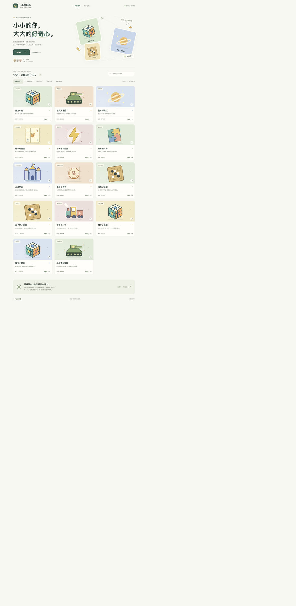

# 游戏大厅验收

验收日期：2026-10-18。本次范围是独立合集、统一入口和游戏接入。

## 自动检查

- Node.js 22.18.0：`npm run build` 成功；Vite 保留原游戏 500 KB chunk 提示，不影响构建。
- `npm test`：7/7 通过（1 个父测试、6 个子测试），覆盖 14 个入口、HTML/HEAD、代理、邀请跳转、目录跳转、错误与私有路径。
- `npm test --prefix games/huang`：16/16 通过。
- `TEST_URL=http://127.0.0.1:8780 npm run test:online`：通过实际大厅的 WebSocket 代理验证房间创建、双端准备、同 tick 状态、隐藏手牌、重连、认输、再战及 AI 出兵。

## Chrome 检查

- 14 个游戏都通过 `play.html` 加载到游戏页面，页面标题和内容正常，已记录资源没有 HTTP 4xx/5xx。
- 搜索“魔方”显示 3 个游戏；无匹配显示空状态；“查看全部游戏”恢复 14 个。
- 棋盘对战分类显示 4 个游戏，切回全部恢复完整目录。
- 随机入口进入有效游戏；全屏按钮成功进入全屏。
- 魔方小岛在 390 px 宽度进入三阶自由练习，点击转动后操作计数与撤回按钮更新；模型及语音资源成功加载。
- 王冠峡谷从大厅进入 AI 练习，创建房间并成功连接同源 WebSocket。
- 返回游乐岛按钮回到首页；无效游戏 ID 显示可返回的提示。
- 首页检查 1440 px 桌面与 390 px 手机模拟尺寸；390 px 下页面宽度为 390 px，没有横向页面溢出。

## 验收边界

手机尺寸由 Chrome 模拟，未做实体手机测试。语音检查是资源加载与控件检查，未做逐条人工听审。
没有逐关重新验收所有游戏，也没有进行公网部署或公网多人测试。
各游戏现有外部字体或资源依赖保留；不承诺完全离线可用。

## 页面截图

